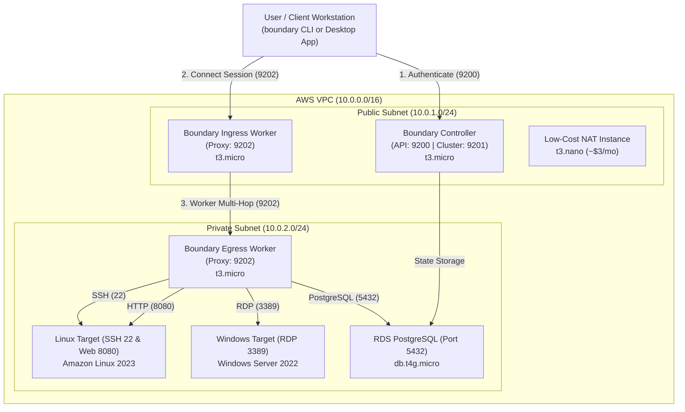

# HashiCorp Boundary on AWS — Multi-Hop Demo Environment

> 🚀 **In a hurry?** See the [Quick Start Guide](QUICKSTART.md).

A cost-optimized AWS deployment of **HashiCorp Boundary**, managed with **HCP Terraform**, demonstrating zero-trust access across the primary use cases:

- **SSH Target (Linux)**: shell access with brokered credentials
- **RDP Target (Windows Server)**: desktop sessions to private instances
- **RDS PostgreSQL Target**: database access with credential brokering
- **HTTP Web Portal Target**: authenticated tunnel to an isolated internal web app

---

## Architecture



**Highlights**

1. **Multi-hop worker routing**: `Client → Ingress Worker (public) → Egress Worker (private, no public IP) → Target`.
2. **Zero-trust isolation**: targets have no public IP. Security groups accept target ports (22, 3389, 5432, 8080) **only from the Egress Worker SG**.
3. **systemd services**: controller and workers run as a dedicated `boundary` user with auto-restart and journald logging.
4. **Cost optimization**: a t3.nano NAT instance instead of a NAT Gateway (toggle `enable_nat_gateway`), and one `db.t4g.micro` serves both the Boundary DB and the demo `appdb`. About **$0.10–0.14 / hour**.
5. **No secrets in the repo**: all target and user passwords are generated per deployment with `random_password` and exposed only as sensitive outputs.

---

## Repository Layout

```
.
├── infra/                       # HCP workspace: boundary-demo-infra (AWS)
│   ├── versions.tf              # cloud block, providers
│   ├── variables.tf
│   ├── network.tf               # VPC, subnets, routing, NAT instance/gateway
│   ├── security_groups.tf       # zero-trust segmentation
│   ├── iam.tf                   # SSM instance profile
│   ├── database.tf              # RDS PostgreSQL
│   ├── kms.tf                   # AEAD keys (root, worker-auth, recovery, bsr)
│   ├── passwords.tf             # generated demo credentials
│   ├── compute_boundary.tf      # controller, ingress & egress workers
│   ├── compute_targets.tf       # Linux and Windows targets
│   ├── controller_health.tf     # waits for the controller API before finishing
│   ├── outputs.tf
│   ├── terraform.tfvars.example
│   └── templates/               # EC2 user-data (*.tftpl)
│
├── boundary-config/             # HCP workspace: boundary-demo-config (Boundary provider)
│   ├── versions.tf              # cloud block, reads infra outputs via remote state
│   ├── variables.tf
│   ├── main.tf                  # scopes, auth, users, hosts, creds, targets, RBAC
│   └── outputs.tf
│
├── scripts/
│   ├── demo-menu.sh             # interactive demo launcher
│   └── bootstrap_boundary.sh    # optional CLI alternative to boundary-config
│
└── .github/workflows/terraform-checks.yml   # fmt + validate on PRs
```

---

## HCP Terraform Setup

Two VCS-driven workspaces in the **Amit_TFC** organization, both connected to this repository:

| Workspace | Working directory | Purpose |
| :--- | :--- | :--- |
| `boundary-demo-infra` | `infra` | AWS infrastructure |
| `boundary-demo-config` | `boundary-config` | Boundary scopes, users, targets, RBAC |

**Wiring**

1. **AWS credentials**: on `boundary-demo-infra`, add the environment variables `AWS_ACCESS_KEY_ID` and `AWS_SECRET_ACCESS_KEY` (both **sensitive**). Add `AWS_SESSION_TOKEN` too if you use temporary credentials.
2. **Remote state sharing**: `boundary-demo-infra` → Settings → General → *Remote state sharing* → share with `boundary-demo-config`.
3. **Run trigger**: `boundary-demo-config` → Settings → Run Triggers → source workspace `boundary-demo-infra`. Optionally enable *Auto-apply run-triggered runs*.
4. **Optional variables** on `boundary-demo-infra`: any variable from [`infra/variables.tf`](infra/variables.tf), e.g. `aws_region`. To pin a password instead of generating one, set `rds_password`, `windows_admin_password`, `linux_ssh_password` or `demo_db_password` as **sensitive** Terraform variables.

> **Network note:** HCP Terraform runners for `boundary-demo-config` call the controller API on port 9200 from the internet. Keep `authorized_client_cidr = "0.0.0.0/0"`, or use an HCP Terraform agent inside the VPC if you need to lock it down.

---

## Deploy

1. Queue a plan on **`boundary-demo-infra`** and apply it (about 6–10 minutes). The apply waits until the controller API responds.
2. **`boundary-demo-config`** is queued automatically by the run trigger. Apply it.
3. Locally, run once:
   ```bash
   terraform login                        # if not already logged in
   terraform -chdir=infra init
   terraform -chdir=boundary-config init
   ```
4. Launch the demo:
   ```bash
   ./scripts/demo-menu.sh
   ```

### Retrieving credentials

```bash
terraform -chdir=boundary-config output -json user_passwords   # Boundary logins
terraform -chdir=infra output -raw windows_admin_password       # RDP Administrator
terraform -chdir=infra output -raw boundary_recovery_key        # recovery KMS key
```

---

## Live Demo Walkthroughs

```bash
export BOUNDARY_ADDR=$(terraform -chdir=boundary-config output -raw boundary_addr)
AUTH_METHOD_ID=$(terraform -chdir=boundary-config output -raw auth_method_id)
# The Boundary CLI reads the login password from this env var
export BOUNDARY_AUTHENTICATE_PASSWORD_PASSWORD=$(terraform -chdir=boundary-config output -json user_passwords | jq -r .admin)

boundary authenticate password -auth-method-id="$AUTH_METHOD_ID" -login-name=admin
```

| Target | Command |
| :--- | :--- |
| Linux SSH (22) | `boundary connect ssh -target-id $(terraform -chdir=boundary-config output -raw linux_ssh_target_id)` |
| Windows RDP (3389) | `boundary connect rdp -target-id $(terraform -chdir=boundary-config output -raw windows_rdp_target_id)` |
| RDS PostgreSQL (5432) | `boundary connect postgres -target-id $(terraform -chdir=boundary-config output -raw rds_postgres_target_id) -dbname appdb` |
| Web Portal (8080) | `boundary connect http -target-id $(terraform -chdir=boundary-config output -raw web_target_id)` |

Inside `psql`, run `SELECT * FROM demo_customers;`. For RDP, log in as `Administrator` with the `windows_admin_password` output.

---

## RBAC Demo

| Persona | Login | Allowed Targets |
| :--- | :--- | :--- |
| **Admin** | `admin` | Everything in Demo-Org |
| **DevOps** | `devops` | Linux SSH (22), Web Portal (8080) |
| **SysAdmin** | `sysadmin` | Windows RDP (3389) |
| **Data Analyst** | `analyst` | RDS PostgreSQL (5432) |

Log in as `analyst`. `boundary connect postgres ...` succeeds, while `boundary connect ssh ...` is denied by policy.

---

## Troubleshooting

All instances have the SSM agent role, so no SSH keys are needed:

```bash
ID=$(aws ec2 describe-instances --filters "Name=tag:Role,Values=Controller" "Name=instance-state-name,Values=running" \
  --query 'Reservations[0].Instances[0].InstanceId' --output text)
aws ssm start-session --target "$ID"
# then: sudo journalctl -u boundary-controller -n 50
```

Use `Role` tag values `IngressWorker` / `EgressWorker` and the `boundary-worker` unit for the workers. User-data logs are in `/var/log/cloud-init-output.log`.

---

## Teardown

Destroy in reverse order to stop AWS charges:

1. `boundary-demo-config` → Settings → Destruction and Deletion → **Queue destroy plan**
2. `boundary-demo-infra` → **Queue destroy plan**

(Destroying infra alone is fine for a throwaway demo. The config workspace's state will then be stale, so destroy or recreate it before redeploying.)

---

## Security Notes (demo only)

This is a demo, not a production reference: TLS is disabled on Boundary listeners and on RDS (`sslmode=disable`), the controller API is open to `authorized_client_cidr`, AEAD keys are kept in Terraform state rather than a KMS, and the Linux target allows SSH password auth. HCP Terraform encrypts state at rest. Restrict access to the workspaces accordingly.
