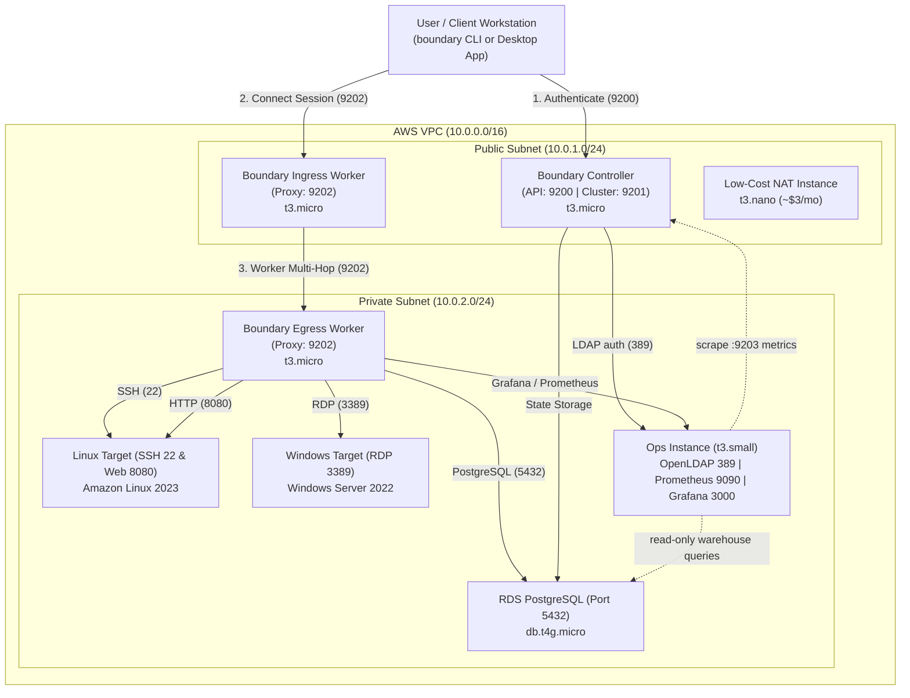

# HashiCorp Boundary Enterprise on AWS — Multi-Hop Demo Environment

> 🚀 **In a hurry?** See the [Quick Start Guide](QUICKSTART.md).

A cost-optimized AWS deployment of **HashiCorp Boundary Enterprise**, managed with **HCP Terraform**, demonstrating zero-trust access across the primary use cases:

- **SSH Target (Linux)**: Enterprise `ssh` target with **credential injection** and **session recording** to S3
- **RDP Target (Windows Server)**: desktop sessions to private instances
- **RDS PostgreSQL Target**: database access with credential brokering
- **HTTP Web Portal Target**: authenticated tunnel to an isolated internal web app

---

## Architecture



**Highlights**

1. **Multi-hop worker routing**: `Client → Ingress Worker (public) → Egress Worker (private, no public IP) → Target`.
2. **Zero-trust isolation**: targets have no public IP. Security groups accept target ports (22, 3389, 5432, 8080) **only from the Egress Worker SG**.
3. **systemd services**: controller and workers run as a dedicated `boundary` user with auto-restart and journald logging.
4. **Cost optimization**: a t3.nano NAT instance instead of a NAT Gateway (toggle `enable_nat_gateway`), and one `db.t4g.micro` serves both the Boundary DB and the demo `appdb`. About **$0.12–0.16 / hour** including the ops instance.
5. **No secrets in the repo**: all target and user passwords are generated per deployment with `random_password` and exposed only as sensitive outputs. The Enterprise license is a sensitive workspace variable (`*.hclic` is gitignored).

---

## Enterprise Features

| Feature | Where | Notes |
| :--- | :--- | :--- |
| **Boundary Enterprise binaries** | controller and both workers | `boundary-enterprise-<boundary_version>+ent` RPM (default 0.19.5+ent) |
| **License** | `boundary_license` workspace variable → SSM SecureString → `/etc/boundary.d/boundary.hclic` | Only the controller can read the parameter. The license never appears in git or user-data |
| **Multi-hop sessions** | `ingress_worker_filter` on every target | Enterprise/HCP only; the community build rejects it ("not supported in OSS") |
| **SSH credential injection** | `linux-ssh-target` (type `ssh`) | The worker logs in to the target for the user, who never sees the password |
| **Session recording** | `linux-ssh-target` → storage bucket `aws-session-recordings` | Workers stage recordings in `/var/lib/boundary/recordings` and upload them to a private, encrypted S3 bucket. Recordings are signed and encrypted with the `bsr` KMS key |

Session recording storage uses **dynamic AWS credentials**. The Boundary AWS plugin, on the controller and on workers tagged `storage = ["s3"]`, assumes the `<env>-boundary-session-recording` IAM role, which only those instance roles can assume and which can only reach that bucket. Private-subnet workers reach S3 through a gateway VPC endpoint.

To view recordings, sign in to the Admin UI as an admin (`admin`, `alice` or `bob`) and go to **Demo-Org → Session Recordings** to play back SSH sessions. You can also use menu option `r` or `boundary session-recordings list -scope-id global -recursive`.

---

## Repository Layout

```
.
├── infra/                       # HCP workspace: boundary-demo-infra (AWS)
│   ├── versions.tf              # cloud block, providers
│   ├── variables.tf
│   ├── network.tf               # VPC, subnets, routing, NAT instance/gateway
│   ├── security_groups.tf       # zero-trust segmentation
│   ├── iam.tf                   # SSM instance profile (targets, NAT, ops)
│   ├── enterprise.tf            # license in SSM, controller/worker IAM, S3 recording bucket
│   ├── database.tf              # RDS PostgreSQL
│   ├── kms.tf                   # AEAD keys (root, worker-auth, recovery, bsr)
│   ├── passwords.tf             # generated demo credentials
│   ├── compute_boundary.tf      # controller, ingress & egress workers
│   ├── compute_targets.tf       # Linux and Windows targets
│   ├── controller_health.tf     # waits for the controller API before finishing
│   ├── ops.tf                   # private ops instance: OpenLDAP, Prometheus, Grafana
│   ├── outputs.tf
│   ├── terraform.tfvars.example
│   └── templates/               # EC2 user-data (*.tftpl), LDAP seed, grafana/ dashboards
│
├── boundary-config/             # HCP workspace: boundary-demo-config (Boundary provider)
│   ├── versions.tf              # cloud block, reads infra outputs via remote state
│   ├── variables.tf
│   ├── main.tf                  # scopes, password auth, users, hosts, creds, targets, RBAC
│   ├── ldap.tf                  # LDAP auth method, managed groups, Grafana/Prometheus targets
│   ├── session_recording.tf     # S3 storage bucket for session recordings
│   └── outputs.tf
│
├── scripts/
│   ├── demo-menu.sh             # interactive demo launcher
│   └── bootstrap_boundary.sh    # optional CLI alternative to boundary-config
│
└── .github/workflows/terraform-checks.yml   # fmt + validate on PRs
```

---

## HCP Terraform Setup

Two VCS-driven workspaces in the **Amit_TFC** organization, both connected to this repository:

| Workspace | Working directory | Purpose |
| :--- | :--- | :--- |
| `boundary-demo-infra` | `infra` | AWS infrastructure |
| `boundary-demo-config` | `boundary-config` | Boundary scopes, users, targets, RBAC |

**Wiring**

1. **AWS credentials**: on `boundary-demo-infra`, add the environment variables `AWS_ACCESS_KEY_ID` and `AWS_SECRET_ACCESS_KEY` (both **sensitive**). Add `AWS_SESSION_TOKEN` too if you use temporary credentials.
2. **Enterprise license**: on `boundary-demo-infra`, add a **sensitive Terraform** variable `boundary_license` containing the contents of your `.hclic` file. Never commit the file.
3. **Remote state sharing**: `boundary-demo-infra` → Settings → General → *Remote state sharing* → share with `boundary-demo-config`.
4. **Run trigger**: `boundary-demo-config` → Settings → Run Triggers → source workspace `boundary-demo-infra`. Optionally enable *Auto-apply run-triggered runs*.
5. **Optional variables** on `boundary-demo-infra`: any variable from [`infra/variables.tf`](infra/variables.tf), e.g. `aws_region`. To pin a password instead of generating one, set `rds_password`, `windows_admin_password`, `linux_ssh_password` or `demo_db_password` as **sensitive** Terraform variables.

> **Network note:** HCP Terraform runners for `boundary-demo-config` call the controller API on port 9200 from the internet. Keep `authorized_client_cidr = "0.0.0.0/0"`, or use an HCP Terraform agent inside the VPC if you need to lock it down.

---

## Deploy

1. Queue a plan on **`boundary-demo-infra`** and apply it (about 6–10 minutes). The apply waits until the controller API responds.
2. **`boundary-demo-config`** is queued automatically by the run trigger. Apply it.
3. Locally, run once:
   ```bash
   terraform login                        # if not already logged in
   terraform -chdir=infra init
   terraform -chdir=boundary-config init
   ```
4. Launch the demo:
   ```bash
   ./scripts/demo-menu.sh
   ```

### Retrieving credentials

```bash
terraform -chdir=boundary-config output -json user_passwords   # Boundary logins
terraform -chdir=infra output -raw windows_admin_password       # RDP Administrator
terraform -chdir=infra output -raw boundary_recovery_key        # recovery KMS key
```

---

## Live Demo Walkthroughs

```bash
export BOUNDARY_ADDR=$(terraform -chdir=boundary-config output -raw boundary_addr)
AUTH_METHOD_ID=$(terraform -chdir=boundary-config output -raw auth_method_id)
# The Boundary CLI reads the login password from this env var
export BOUNDARY_AUTHENTICATE_PASSWORD_PASSWORD=$(terraform -chdir=boundary-config output -json user_passwords | jq -r .admin)

boundary authenticate password -auth-method-id="$AUTH_METHOD_ID" -login-name=admin
```

| Target | Command |
| :--- | :--- |
| Linux SSH (22) | `boundary connect ssh -target-id $(terraform -chdir=boundary-config output -raw linux_ssh_target_id)`. No password prompt (injected), and the session is recorded |
| Windows RDP (3389) | `boundary connect rdp -target-id $(terraform -chdir=boundary-config output -raw windows_rdp_target_id)` |
| RDS PostgreSQL (5432) | `boundary connect postgres -target-id $(terraform -chdir=boundary-config output -raw rds_postgres_target_id) -dbname appdb` |
| Web Portal (8080) | `boundary connect -listen-port 8080 -target-id $(terraform -chdir=boundary-config output -raw web_target_id)`, then open http://127.0.0.1:8080 |

Inside `psql`, run `SELECT * FROM demo_customers;`. For RDP, log in as `Administrator` with the `windows_admin_password` output.

---

## Authentication

Demo-Org has two auth methods:

| Auth method | Type | Who | How |
| :--- | :--- | :--- | :--- |
| `corp-ldap` (**primary**) | LDAP → OpenLDAP on the ops instance | Directory users `alice`, `bob` (group `boundary-admins`) and `carol`, `dave`, `erin` (group `boundary-users`) | `boundary authenticate ldap -auth-method-id <ldap_auth_method_id> -login-name alice` |
| `corp-password-auth` | Password (stored in Boundary's DB) | Local personas `admin`, `devops`, `sysadmin`, `analyst` | `boundary authenticate password -auth-method-id <auth_method_id> -login-name admin` |

**How LDAP login works:** the controller binds to OpenLDAP as `cn=readonly` and looks up `uid=<login>` under `ou=people`. It verifies the password with a bind as that user, then reads the user's groups under `ou=groups` (`groupOfNames`, attribute `cn`). Boundary **managed groups** map LDAP group names to Boundary principals:

| LDAP group | Managed group | Boundary role | Access |
| :--- | :--- | :--- | :--- |
| `boundary-admins` | `ldap-boundary-admins` | `org-admin-role` | Everything in Demo-Org, including the Grafana and Prometheus targets |
| `boundary-users` | `ldap-boundary-users` | `ldap-users-role` | Connect to SSH, RDP, Postgres and Web targets |

Because `corp-ldap` is primary for the org, Boundary creates a user automatically on the first LDAP login. To add someone, add them to `ldap_users` in [`infra/variables.tf`](infra/variables.tf) (or as a workspace variable). Their LDAP group decides their access, so you don't need to change any Boundary roles.

```bash
terraform -chdir=infra output -json ldap_users    # LDAP logins, groups and passwords
```

Terraform itself never logs in as a user: it uses the recovery KMS key. `boundary database init` also creates a bootstrap password auth method in the **global** scope, whose admin credentials are written only to `/etc/boundary.d/db-init.log` on the controller.

---

## Monitoring & User Activity

The ops instance runs **Prometheus** and **Grafana**. Neither has a public IP: admins reach them **through Boundary** (menu options `g` / `p`, or `boundary connect -listen-port 3000 -target-id <grafana_target_id>`), then open http://127.0.0.1:3000 and log in as `admin` with `terraform -chdir=infra output -raw grafana_admin_password`.

Two dashboards are provisioned in the **Boundary** folder:

| Dashboard | Source | Shows |
| :--- | :--- | :--- |
| **Boundary - User Activity** (home) | Boundary data warehouse in Postgres (read-only `grafana_ro` role, `wh_*` tables only) | Who logged in, how many times, approx. active hours per user, session hours per user and target, live sessions, login log |
| **Boundary - Cluster Metrics** | Prometheus scraping the `:9203/metrics` ops listener on the controller and both workers | Node up/down, API rate/latency/status codes, authentication requests, proxy connections and throughput per worker, cluster gRPC |

**Why two sources:** Boundary's Prometheus metrics are aggregate and carry no user labels. Per-user history comes from Boundary's built-in data warehouse:

- `wh_auth_token_accumulating_fact`: one row per login, with issue time and approximate last activity. "Active hours" is the time from login to last token use. Boundary only updates the last-use time periodically, so treat it as approximate.
- `wh_session_accumulating_fact`: one row per session, with exact active and terminated times and bytes transferred.
- `wh_user_dimension`: user, auth method and account. For LDAP users, the login name is shown.

---

## RBAC Demo

| Persona | Login | Allowed Targets |
| :--- | :--- | :--- |
| **Admin** | `admin` | Everything in Demo-Org |
| **DevOps** | `devops` | Linux SSH (22), Web Portal (8080) |
| **SysAdmin** | `sysadmin` | Windows RDP (3389) |
| **Data Analyst** | `analyst` | RDS PostgreSQL (5432) |
| **LDAP admins** | `alice`, `bob` | Everything, plus Grafana / Prometheus |
| **LDAP users** | `carol`, `dave`, `erin` | SSH, RDP, Postgres, Web |

Log in as `analyst`. `boundary connect postgres ...` succeeds, while `boundary connect ssh ...` is denied by policy.

---

## Troubleshooting

All instances have the SSM agent role, so no SSH keys are needed:

```bash
ID=$(aws ec2 describe-instances --filters "Name=tag:Role,Values=Controller" "Name=instance-state-name,Values=running" \
  --query 'Reservations[0].Instances[0].InstanceId' --output text)
aws ssm start-session --target "$ID"
# then: sudo journalctl -u boundary-controller -n 50
```

Use `Role` tag values `IngressWorker` / `EgressWorker` and the `boundary-worker` unit for the workers. On the `Ops` instance, run `sudo docker compose -f /opt/ops/docker-compose.yml ps` / `logs openldap`. User-data logs are in `/var/log/cloud-init-output.log`.

---

## Teardown

Destroy in reverse order to stop AWS charges:

1. `boundary-demo-config` → Settings → Destruction and Deletion → **Queue destroy plan**
2. `boundary-demo-infra` → **Queue destroy plan**

(Destroying infra alone is fine for a throwaway demo. The config workspace's state will then be stale, so destroy or recreate it before redeploying.)

---

## Security Notes (demo only)

This is a demo, not a production reference: TLS is disabled on Boundary listeners and on RDS (`sslmode=disable`), the controller API is open to `authorized_client_cidr`, AEAD keys are kept in Terraform state rather than a KMS, the Linux target allows SSH password auth, and LDAP runs without TLS, with plaintext `userPassword` values. HCP Terraform encrypts state at rest. Restrict access to the workspaces accordingly.
